# Tick Tock Crew: final QA pass

Tested `main` at 6dc947c on 2026-11-02/03, in a `qa/final` worktree against the dev deployment (basic-swan-476), with Vite dev on :5180 and `vite preview` on :5181. Playwright 1.59.1 / Chromium ran 3–6 guest contexts with fake media devices. Most runs were in Arabic; match 3 ran fully in English.

**Verdict: PASS, with one bug fixed on `qa/final`** (mid-match errors never cleared). See [Fixes](#fixes).

Matches played: 5 (easy lost to 3 strikes after a self-burst, hard lost on time, normal in English won, hard lost on time after a burst, easy lost to 3 strikes).

| # | Area | Result |
| --- | --- | --- |
| 1 | Language | PASS |
| 2 | Lobby | PASS |
| 3 | Role views | PASS |
| 4 | Modules | PASS |
| 5 | Strikes | PASS |
| 6 | Pause and reconnect | PASS |
| 7 | Play again | PASS |
| 8 | Voice | PASS |
| 9 | Pings and emotes | FIXED |
| 10 | Robustness | PASS |
| 11 | Build | PASS |

## 1. Language: PASS

- The page loads with `<html lang="ar" dir="rtl">`. Digits are Western (clock `5:54`, `الأخطاء: 1 من 3`, `الوحدات المفكّكة: 2 من 4`).
- After switching to English, a reload stays `en/ltr`. All 4 contexts switched back and forth.
- No raw i18n keys showed in the body text of any open page (regex scan). Every rejected mutation showed a translated message: `ROOM_NOT_FOUND` → «الغرفة غير موجودة», `SEAT_TAKEN` → «هذا المقعد محجوز», `TOO_MANY_PINGS` → «تمهّل…». `ar` and `en` have the same keys (only the extra Arabic plural forms differ).

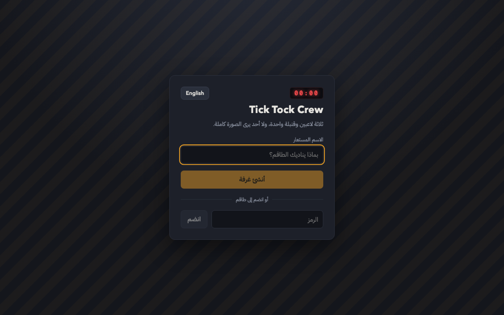
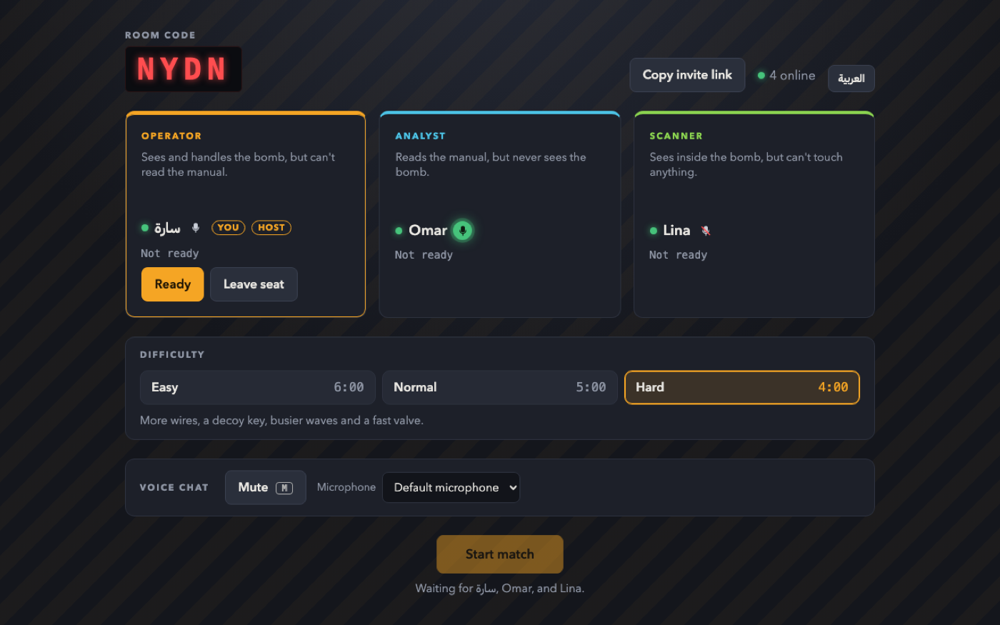

## 2. Lobby: PASS

- **Create and join:** the host created a room. A second player joined by typing the code in lowercase, and a third opened `/room/<code>` in lowercase. A wrong code shows «الغرفة غير موجودة», and `/room/QQQQ` shows the not-found page.
- **Name validation:** Create, Join and Claim stay disabled for an empty or whitespace-only name. The server rejects 21 characters and blank names with `NICKNAME_LENGTH` (max 20).
- **Seat conflicts:** two players clicked the scanner seat at the same moment. One got it, and the other saw «هذا المقعد محجوز» and kept their old seat.
- **Ready:** Start is enabled only when all three are ready. When one unreadies, the host sees «بانتظار Omar», and calling `startMatch` directly returns `PLAYERS_NOT_READY`.
- **Difficulty:** the picker is disabled for non-hosts (inputs disabled; a forced click does nothing; `setDifficulty` returns `HOST_ONLY`). The host's choice appears for all 3 players.
- **Host transfer:** when the host closed their page, the Analyst (first present seat) became host and got the picker. When the creator came back, hosting returned to them.
- **4th player:** joins as a spectator. Every seat claim returns `SEAT_TAKEN`, ready returns `SEAT_REQUIRED`, start and difficulty return `HOST_ONLY`, and the seats are unchanged. In a match the spectator sees «مُشاهد» and gets no role view.
- **Hidden tab:** the tab was set to hidden (`document.hidden` plus `visibilitychange`), then frozen through CDP (`Page.setWebLifecycleState frozen`) for 70 s. The other players saw it online throughout.

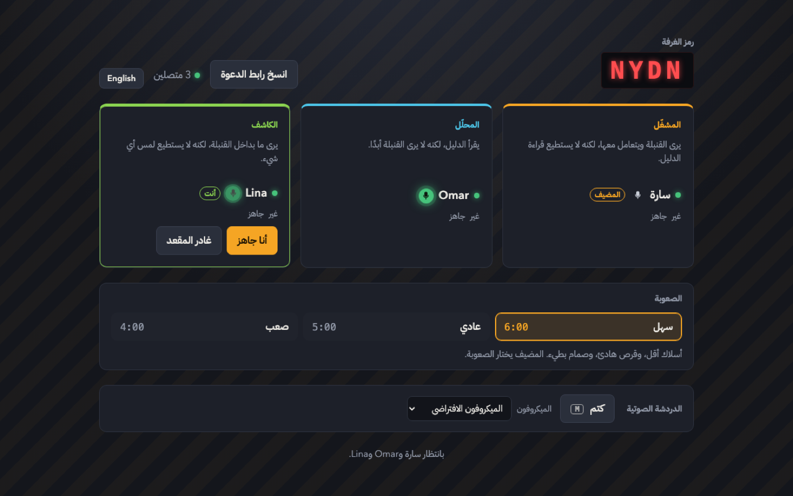

## 3. Role views: PASS

We captured WebSocket frames for each player from the start of the match.

| Field | Operator | Scanner | Analyst | Spectator |
| --- | --- | --- | --- | --- |
| serial | yes | **no** | **no** | no |
| wire colors / handle / glyphs | yes | **no** | **no** | no |
| tags / live key / waveform / coils / gauge | **no** | yes | **no** | no |
| manual | no | no | yes | no |
| seed | no | no | no | no |

- The Analyst's frames carry the manual's static color table and nothing about the bomb, and the Analyst's scene shows only the booth.
- Scanner, Analyst and spectator calls to `cutWire` return `OPERATOR_ONLY`. A Scanner click on a wire changed nothing.

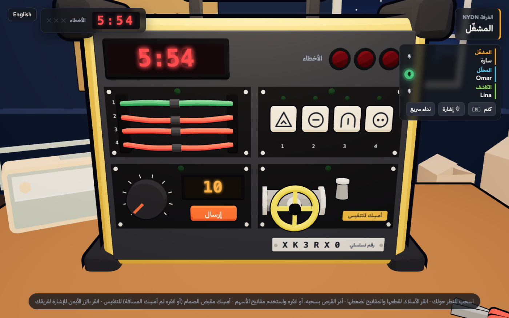
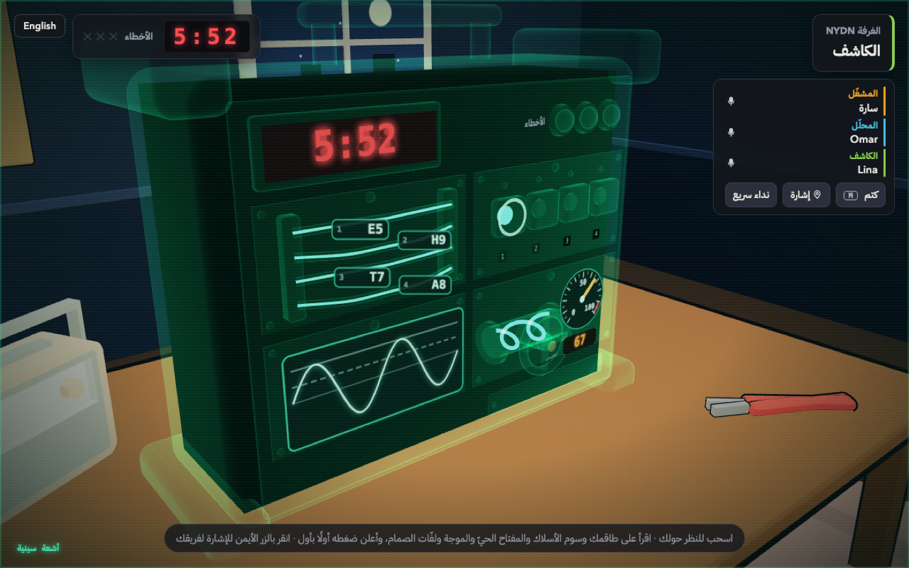
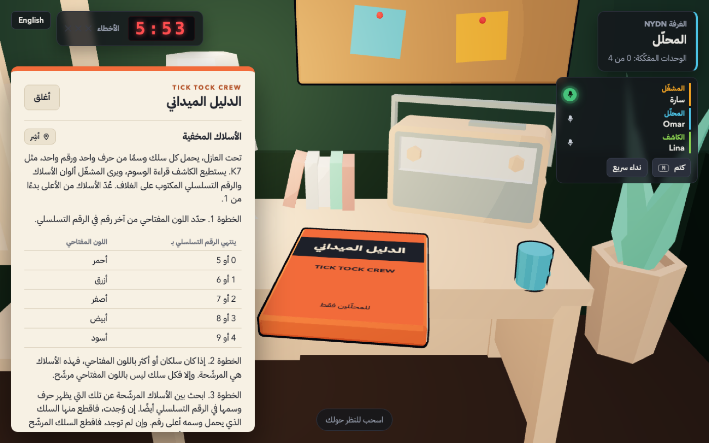

## 4. Modules: PASS

We worked each solution out from the Operator's and Scanner's server views plus the manual tables in the Analyst's view, then entered it through the real UI: canvas clicks on wires and keys, the dial's slider with arrow keys and Enter, and the valve held with Space.

- **Wires** (serial XK3RX0 → key color red; 3 red wires are the candidates; no tag letter appears in the serial → lowest digit, T7, which is wire 3): cutting wire 1 gave «سلك خاطئ! سُجّل خطأ.» and a strike. Cutting wire 3 gave «قطعٌ سليم! فُكّكت الوحدة.». In match 3, CM1HX2 → wire 3 was also correct.
- **Keypad** (ring 2, live key 1, odd first digit so the walk goes down → 1, 4, 3, 2): pressing key 2 first was a strike, then 1, 4, 3, 2 defused it. In match 3, pressing the keys in the derived order 1-2-3-4 also defused it. In a hard match, the decoy key showed up as the key outside the ring.
- **Dial** (smooth, no A/E in the serial → 57 + 2×6 = 69): 69 solved it. In match 3 (ramp, 2 peaks, CM1HX2 → 40), sending 41 was a strike and 40 solved it.
- **Valve:**
  - A 0.6 s hold released above the band: «Sealed outside the band. Strike!» (match 3, English), a strike, and the needle went back to its start.
  - Releasing at about 10 inside the band 5–17 (green handle, 4 coils) solved it.
  - Self-burst: an untended valve reached 100 and every role saw «انفجر الصمام: بلغ الضغط 100. خطأ!» (match 1 lost on this third strike; it also burst in match 4).

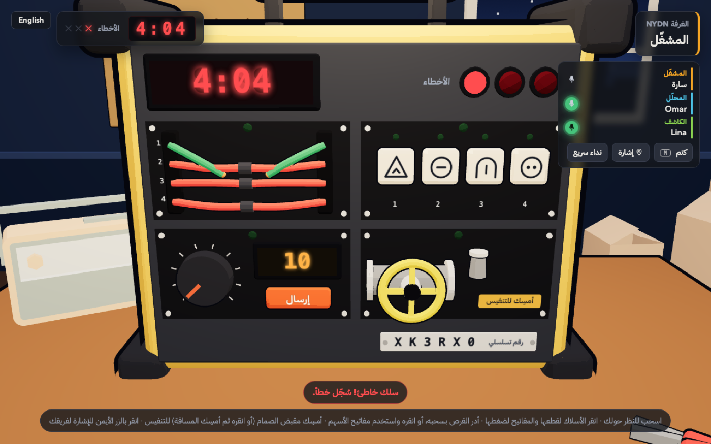

## 5. Strikes: PASS

- The HUD and the bomb's strike lamps light per strike for all roles (`الأخطاء: 1 من 3`).
- **3 strikes:** loss, explosion, «ثلاثة أخطاء. انفجرت القنبلة.» (twice).
- **Timer expiry:** loss, «انتهى الوقت. انفجرت القنبلة.» (twice, at 1 strike).
- **Win:** «SAFE» on the bomb, confetti, «You won».
- **Timers at start:** easy `6:00` (read 5:56 four seconds in), normal `5:00`, hard `4:00` (read 3:57 three seconds in).

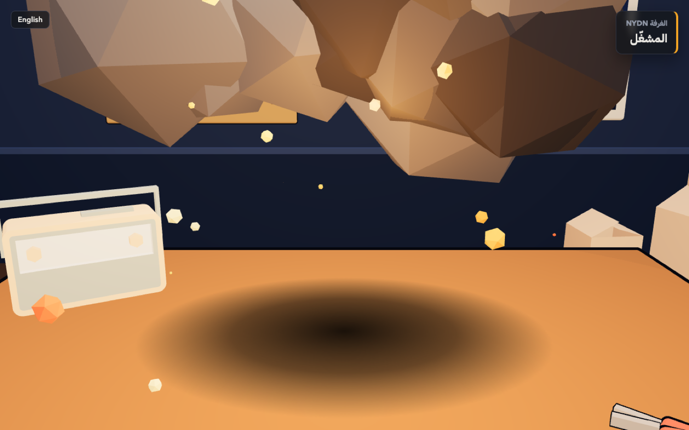
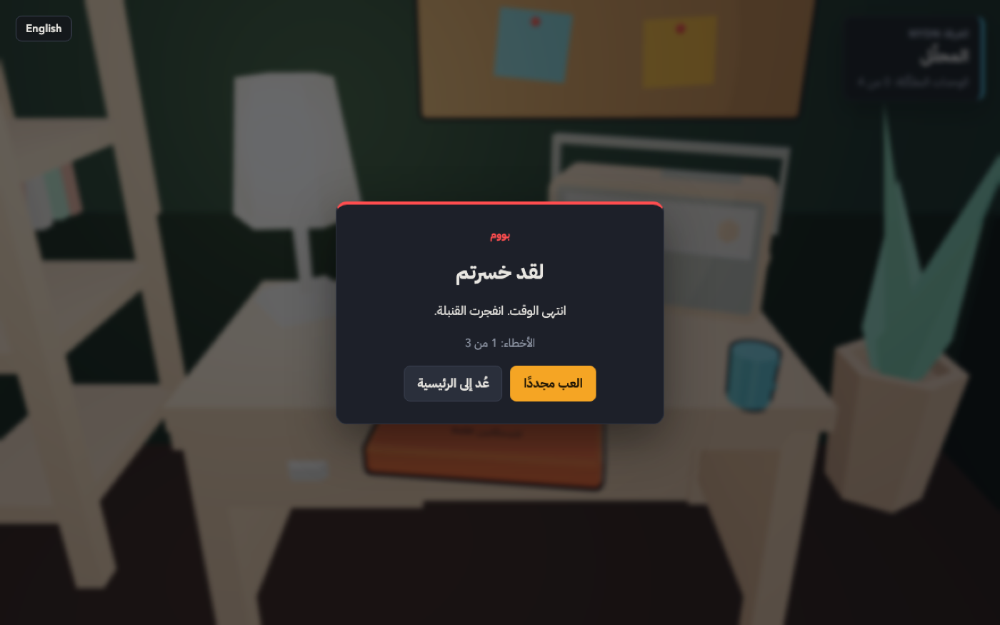
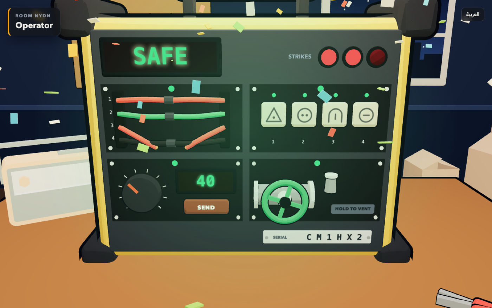

## 6. Pause and reconnect: PASS

- **Pause:** after the Scanner's page closed, the server status was `paused` at 6.6 s (5 s grace plus polling). The overlay names the missing seat, and the clock stayed at 2:28 over 3 s.
- **Inputs refused:** `tuneDial` and `holdValve` return `MATCH_PAUSED`, and the bomb Ping button is hidden.
- **Reload resumes:** the Scanner reopened the page and play resumed in 1.9 s. The clock picked up from 2:28.
- **Spectator takeover:** the overlay offered the spectator «تولَّ دور الكاشف». After they took it, the match resumed and they became the Scanner.
- **No flash on a quick reload:** a MutationObserver on the other 3 pages never saw `.pause-screen`, and the server never paused, during 10 s around the reload.

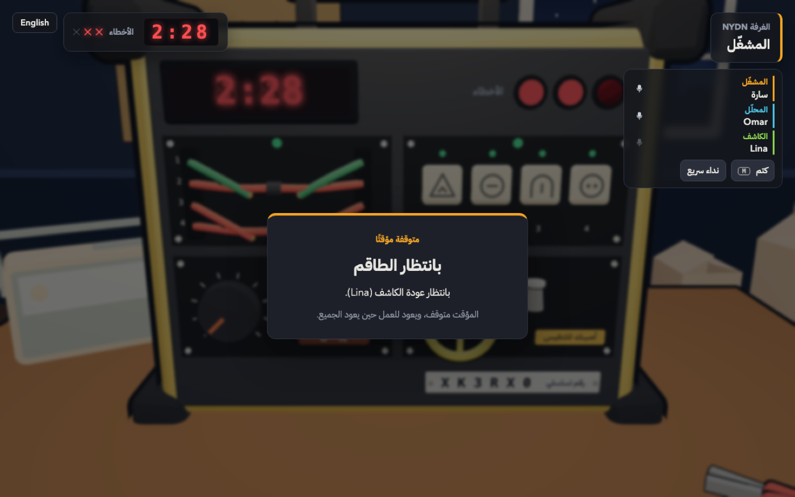
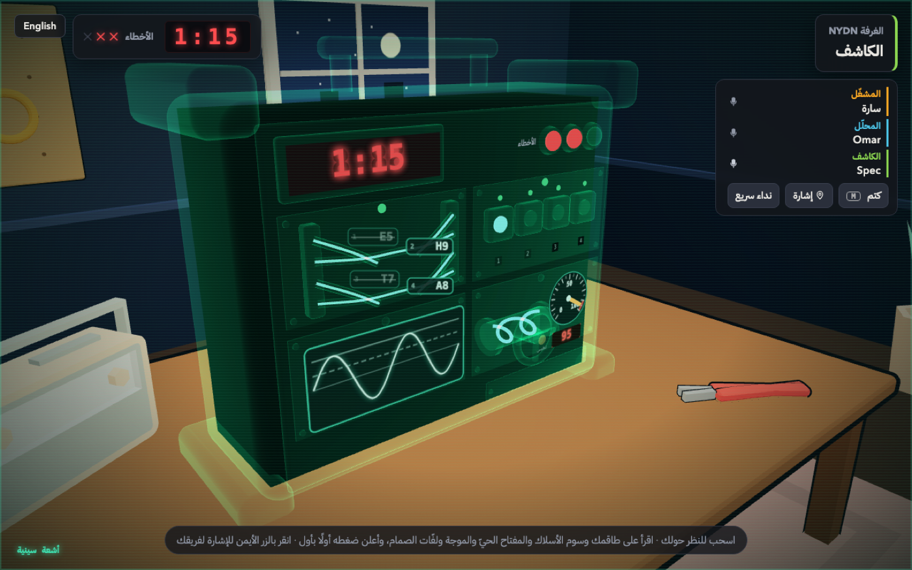

## 7. Play again: PASS

- Play again (4 times) brought everyone back to the same `/room/NYDN` lobby. Seats and difficulty were kept, and every seat was «غير جاهز».
- Each start rolled a new bomb: serials XK3RX0, TE0TA8, CM1HX2, then 2 more.

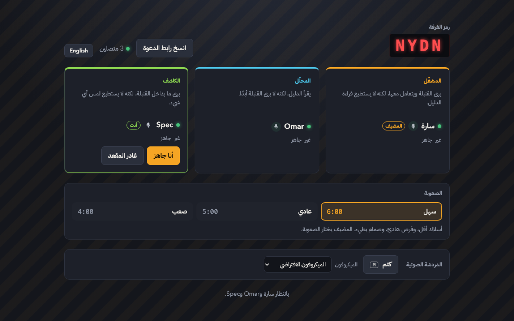

## 8. Voice: PASS

A test-only init script recorded each RTCPeerConnection, and `getStats()` was read from the page.

- **Connection:** all 3 pairs reached `connected`, with inbound audio bytes rising on every link (for example 17,954 → 27,071 in 3 s).
- **Mute:** pressing M, and the button, showed `muted` and then `idle` on both other players' badges.
- **Mic denial:** simulated by having `getUserMedia` reject with NotAllowedError. The panel says the mic is blocked and that the player can still hear the team, and offers a retry. The other players show `listening`. Links stay connected with inbound bytes rising and 0 outbound.
- **Reload:** all three reloaded at once, then one reloaded alone. Both links of the reloaded player came back to `connected` with audio flowing.

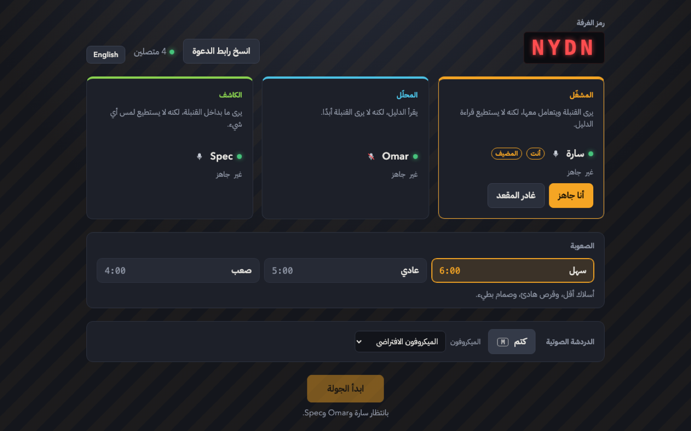
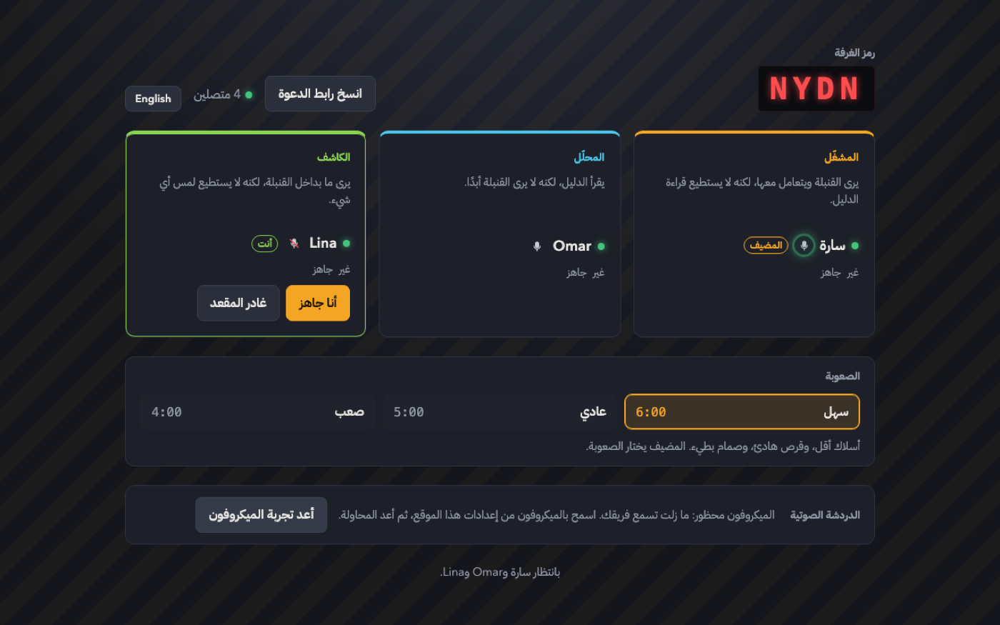

## 9. Pings and emotes: FIXED

- **Bomb pings:** right-clicks pinged a wire (Scanner), and a key, the dial and the valve (Operator). The other bomb role saw each one highlighted in the sender's color, and every seated role got a callout («إشارة إلى المفتاح 2 · لوحة الرموز», «… قرص التردد», «… صمام الضغط»).
- **Manual ping:** the Analyst's ping on the valve section highlights it and shows «إشارة إلى الدليل: صمام الضغط» to the others.
- **Emote wheel:** 6 calls; a click or the 1–6 keys send one, and the others see it as a toast.
- **Rate limit:** a 4th live ping returns `TOO_MANY_PINGS` and shows «تمهّل…». **Bug:** that message never cleared; it was still on screen two minutes later (see the before shot, at 0:16). Fixed in `a445756`: it now clears after 4 s, verified gone 5.5 s later.
- **No leaks:** the ping list carries only `{kind, module, wire|key}`, `{kind:"manual", section}` or `{kind:"emote", emote}`. The Analyst can't ping the bomb and the Operator can't ping the manual (`PING_NOT_ALLOWED`). An out-of-range wire returns `PING_TARGET_NOT_FOUND`, and a spectator's list is empty.

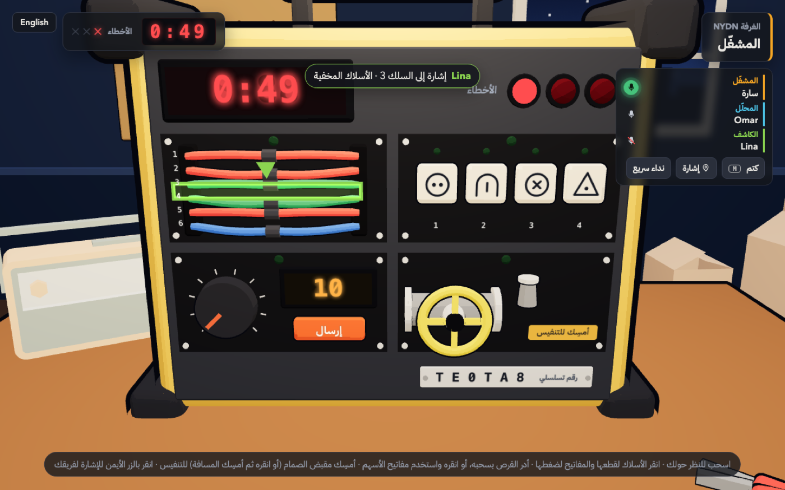
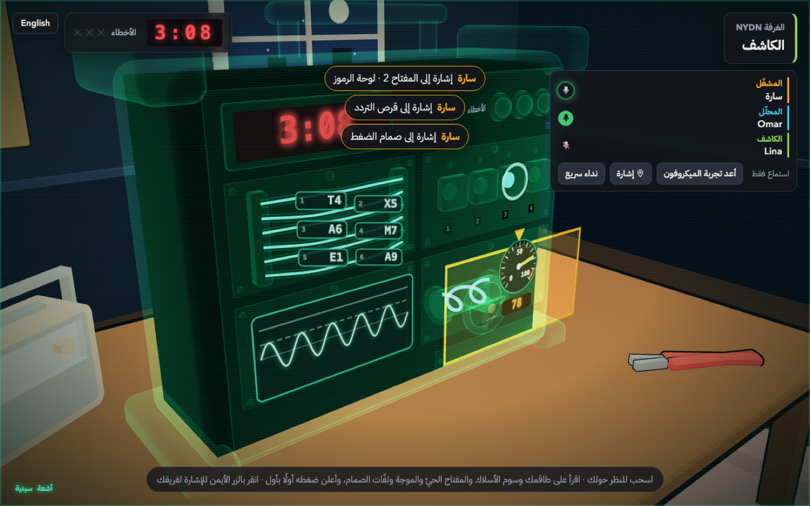
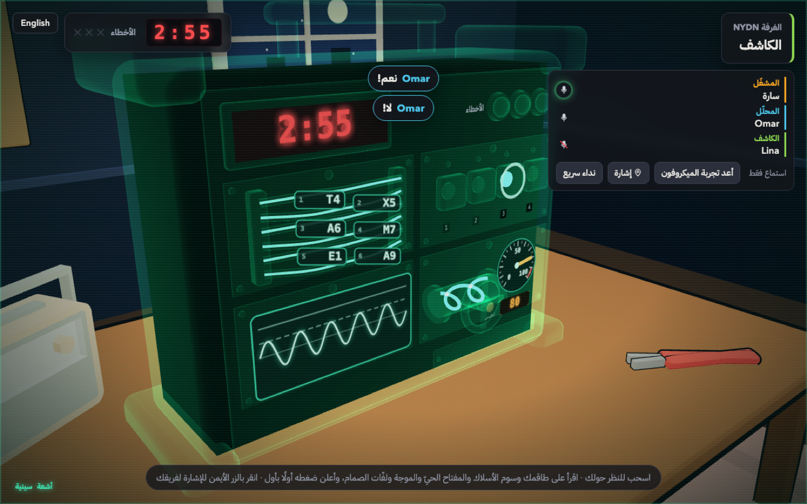

## 10. Robustness: PASS

- **Console:** no `pageerror` or unhandled rejection in any run. The only `console.error` lines are the Convex client logging mutations we rejected on purpose (`ROOM_NOT_FOUND`, `SEAT_TAKEN`, `TOO_MANY_PINGS`). Warnings: `THREE.Clock` is deprecated (from three/R3F), and a GL `ReadPixels` stall during screenshots.
- **Phone width (390×844):** no horizontal scroll (scrollWidth 390). The clock, strikes, crew bar, Ping, Emote, Mute, hint and manual sheet are all inside the viewport. *Note:* the bomb is cropped at this width (keys 3–4 are off screen until you drag to look).
- **`prefers-reduced-motion: reduce`:** the Analyst's lost finale darkens without the bright flash. The camera shake and the 3D flash light are off in code when reduced motion is set (`Scene.tsx`, `Finale.tsx`). We didn't measure the shake itself.

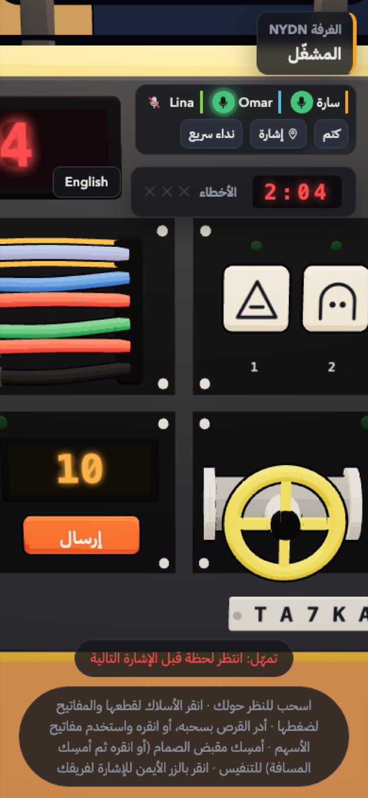
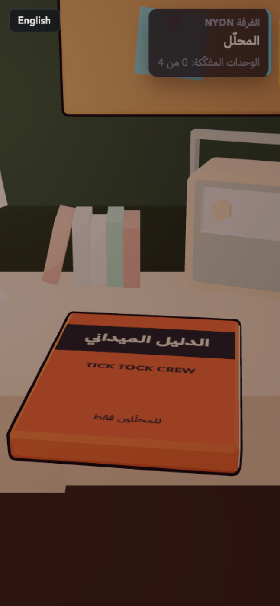

## 11. Build: PASS

- `bun run typecheck`: all 3 packages exit 0.
- `bun run test`: rules 66, backend 73, web 38, all passing. After the fix, web tsc and its 38 tests pass again.
- `vite build`: done in 650 ms. It warns that `Scene` is a 1.05 MB chunk.
- `vite preview`: `GET /room/ABCD` returns 200, and the SPA opens the room route («الغرفة ABCD غير موجودة»).

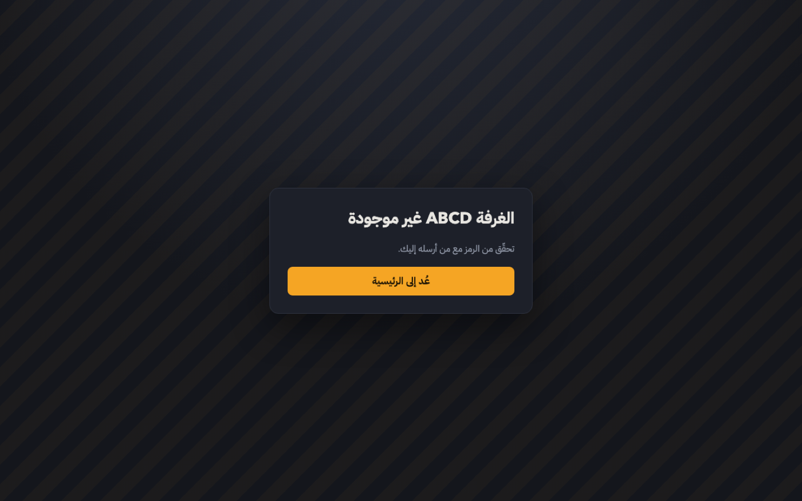

## Fixes

**Mid-match errors never cleared** (`a445756` on `qa/final`)

Repro:
1. As the Operator, right-click 4 bomb parts in under 5 s.
2. «تمهّل: انتظر لحظة قبل الإشارة التالية» appears.
3. Wait: it stays until the end of the match.

The same happens with an Operator error such as `MATCH_PAUSED`, which stays after the match resumes.

Fix: `useMutationError({ transient: true })` clears the message after 4 s. It is used by `usePings` and `useOperator`; lobby and home errors still stay until the next action.

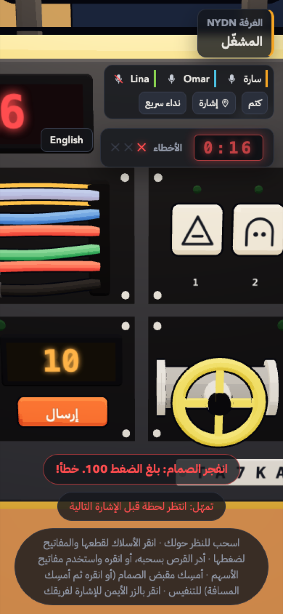
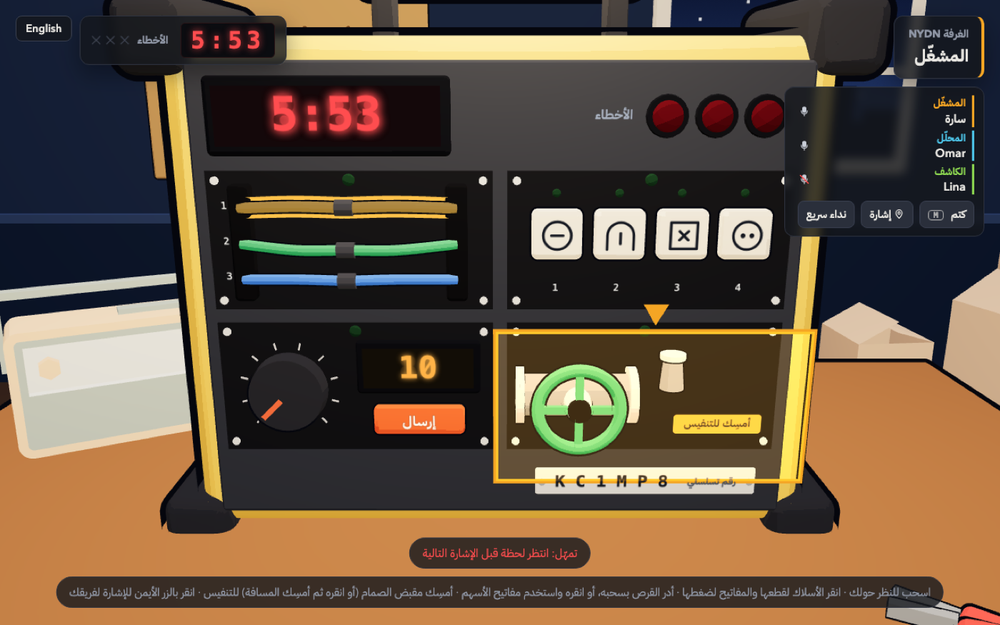

## Notes (not fixed)

- At phone width the bomb is cropped. The HUD works, but the Operator has to drag to reach keys 3–4.
- The server accepts bomb pings while the match is paused (by design: "the crew can still point things out"). The client hides the button.
- Test limits:
  - The hidden tab was emulated (headless Chrome can't really hide one).
  - The mic denial was simulated with a rejecting `getUserMedia`.
  - The reduced-motion camera shake was checked in code, not measured.
